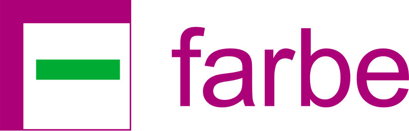

# Farbe

Display statistics of used colors in CSS and SCSS files.

Farbe means "color" in German language.

**Warning: under construction...**

## Notes

Please see the `notes/` folder.

## Console Example of the Program

## Install

[First, you need to install Rust on your system.](https://www.rust-lang.org/tools/install)

## Run

In the project folder, execute: `cargo run`

## Tests

Use: `cargo test`

## Build

Run this command: `cargo build --release`

## License

This repository uses separate licenses for source code and assets.

- **Source code:** MIT License  
  Copyright (c) 2026-present Adam Burucs.
  See [LICENSE](LICENSE).

- **Assets:** Creative Commons Attribution-NonCommercial 4.0 International
  (CC BY-NC 4.0).
  This applies to files in the `assets/` directory unless otherwise stated.
  See [assets/LICENSE](assets/LICENSE).

## History

- October 2026: project start.
